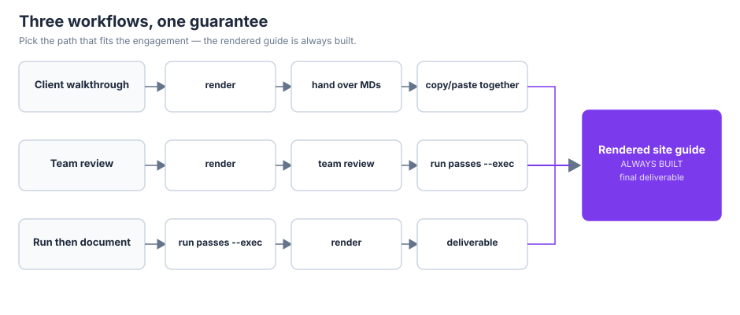
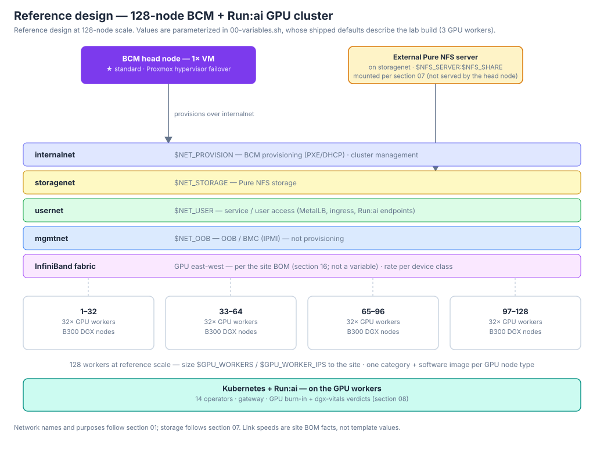
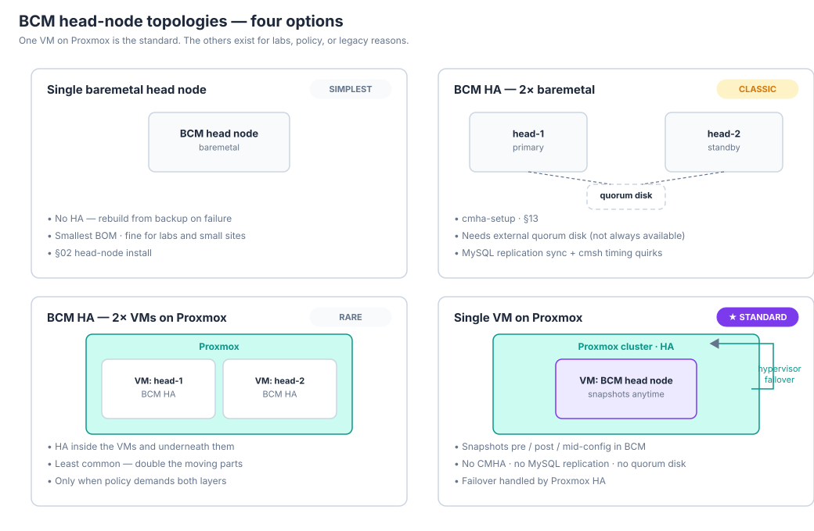
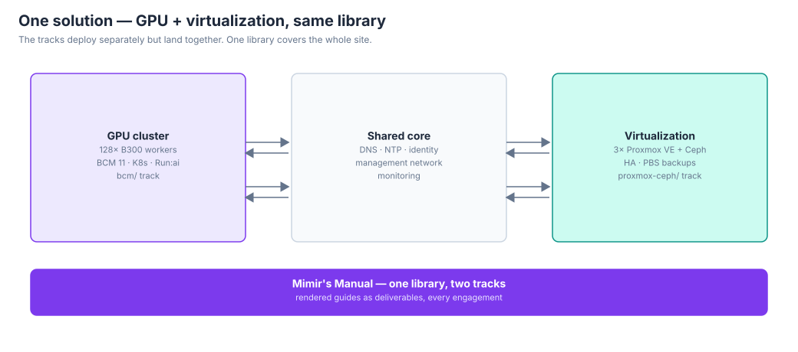
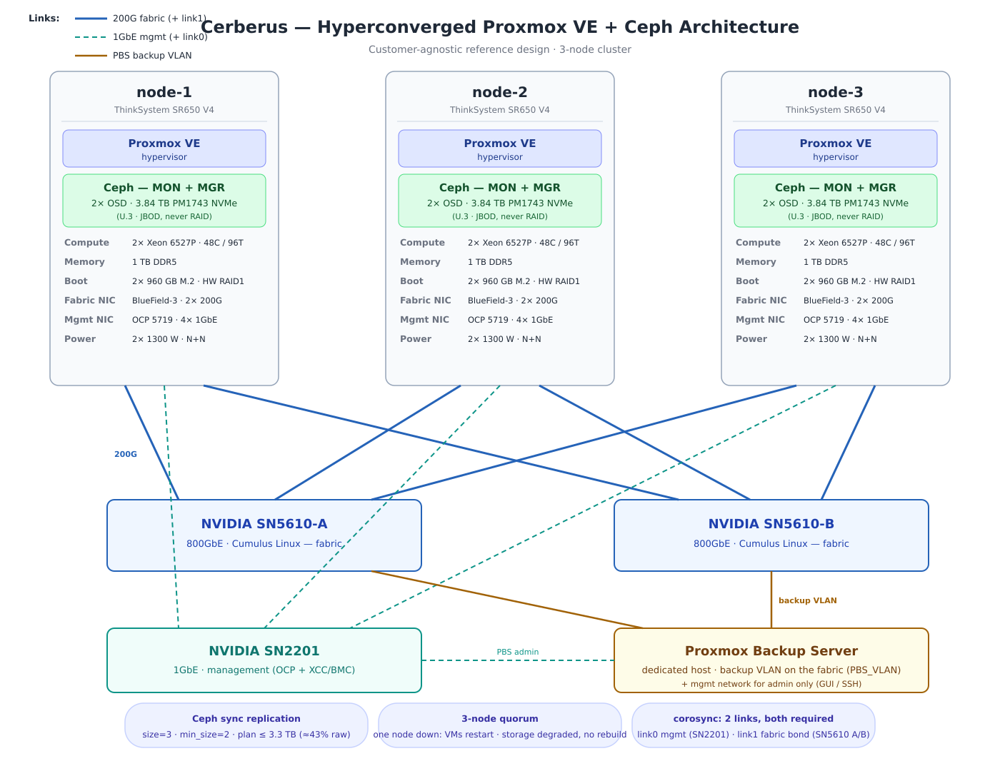

# Mimir's Manual

> The runbook library — executable, customer-anonymized deployment recipes
> for GPU and virtualization infrastructure. Pick a track, companyify it,
> build.

`library 1.0.0` · anonymous by design · Python floors per component (see
[Requirements](#requirements))

**Versions in this assembly:** BCM track `version 0.9.0` (BCM 11,
Kubernetes 1.34, Run:ai 2.26.x — the 08.3 field note lists the stack) ·
Proxmox-Ceph track (Cerberus): PVE 9.2.x, Ceph Tentacle 20.2.x, PBS 4.2;
customer design brief Version 1.1 · DGX Vitals **2.0** (`VERSION = "2.0"`
in both tools), byte-identical to the canonical `dgx-vitals` repo at
commit `01fb620`. Vendor claims the library could not check are listed,
with their status, in
[`docs/verification-checklist.md`](docs/verification-checklist.md).

## Just want one piece?

You don't have to take the whole library. The components below are
self-contained — each runs and tests on its own (Python floor per
component: see [Requirements](#requirements)). Take only the piece you
need with a sparse checkout:

```
git clone --filter=blob:none --sparse https://github.com/LokiX1/mimirs-manual.git
cd mimirs-manual
git sparse-checkout set dgx-vitals
```

Swap the last line for the piece you want:

- `dgx-vitals` — **DGX Vitals**, the DGX health and validation tool.
  The one to take for installs without the full BasePod stack.
- `veil` — **Mimir's Veil**, the anonymizer: scrub a document or bundle
  before it leaves the site.
- `proxmox-ceph` — **Cerberus**, the Proxmox VE + Ceph hyperconverged
  runbook.

Update later with a plain `git pull` inside the checkout. (On the CDW
side, clone the AltonHill mirror of this repo instead — the same
commands apply.)

## The tracks

| Track | Stack | Directory | For |
|---|---|---|---|
| **BCM** | BCM 11 + Kubernetes + NVIDIA Run:ai on DGX GPU nodes | `bcm/` | GPU clusters, AI factories — the 74× B300 rollout and beyond |
| **Proxmox-Ceph** (*Cerberus*) | Proxmox VE + Ceph, hyperconverged, 3 nodes | `proxmox-ceph/` | General virtualization on NVMe — synchronous replication, PBS, HA |

Each track is a complete, standalone deployment package: its own
README, its own variables file, its own scripts. A site may take one
track alone, but in practice the two land together — the GPU cluster
and its virtualization under one solution — which is why they live in
one library.

## Companion tool — DGX Vitals

`dgx-vitals/` is the library's validation runner (family nickname
*mimirs-test* — "Mimir's Manual's test tool"; the nickname is used only
here). One Python script takes a DGX or HGX node's vitals — platform
profiles (`--profile dgx|hgx`), NVLink topology, and an NCCL suite
(all_reduce / all_gather / reduce_scatter with a correctness gate and
peak bus bandwidth) — on a single node or a whole fleet over SSH, and
files the evidence: full log, health card, tracker-ready summary. The
tracks stand the machines up; Vitals proves they're healthy. **BCM 08.6
runs it, and the 11.3 handoff gates on its verdicts.**

**Provenance.** The tool's source of truth is its own repo (`dgx-vitals`).
The copy here is an assembly of it: byte-identical to canonical commit
`01fb620` (VERSION 2.0), leaving out only the canonical repo's `tests/`
and `.gitattributes`. `dgx-vitals/README.md` is the tool's own README and
says nothing about this library — this paragraph is the provenance
record. Start with the tool's two entry points:
[`dgx-vitals/QUICKSTART.md`](dgx-vitals/QUICKSTART.md) (first run) and
[`dgx-vitals/docs/OPERATORS-GUIDE.md`](dgx-vitals/docs/OPERATORS-GUIDE.md)
(the full guide).

## Cold start — one path, start to finish

Work it top to bottom. The **standard topology** puts the BCM head node
in a VM on the Cerberus cluster, so Cerberus is built first. With a
baremetal head node, the two tracks are independent: skip part B or do
it in parallel.

**Time estimates** are planning estimates, not measurements: one
experienced engineer, hardware racked, the customer's answers on hand.
Record the real numbers in BCM section 10 and replace these over time.

### Part A — before any hardware

| # | Step | Estimate |
|---|---|---|
| A1 | **Read.** This page, then `bcm/README.md`, `bcm/00-overview.md`, `proxmox-ceph/README.md` and `proxmox-ceph/runbook/00-overview/README.md`. Skim the [glossary](#glossary). | 1–2 h |
| A2 | **Get the library and run both gates** (commands below). Green on a clean copy is the baseline. | 15–30 min |
| A3 | **Design intake.** BCM `00a`–`00d` (customer inputs, sizing, decisions, assumptions). Verify the Kubernetes ranges against the customer's **existing** networks, not just this plan. Cerberus 00-overview, and **if the site is flat**, `proxmox-ceph/docs/site-profile-flat.md` now — it changes Ceph and corosync addressing. Plan the two tracks' networks together: once both site files exist (A4), the BCM gate's cross-track stage fails on any overlap between them (checklist X-1). | 1–3 days (customer-dependent) |
| A4 | **Companyify both site files and validate** (commands below). | 2–4 h |
| A5 | **Greenfield only: BCM 14** — jumpbox, DNS, time sync, before 01's IP plan goes live. | 0.5–1 day |

```bash
# A2 — get the library (repo name: mimirs-manual) and run both gates
LIBRARY_URL="${LIBRARY_URL:?set LIBRARY_URL to the library git URL (ask the maintainer)}"
git clone "$LIBRARY_URL" mimirs-manual && cd mimirs-manual
bcm/scripts/check.sh --site            # on site: every stage but the leak scan — green = exit 0
bash proxmox-ceph/scripts/check.sh     # green = exit 0 (needs pdftotext; fails closed without it)

# A4 — companyify: copy each pristine template to its site file (both
#      gitignored), fill in the COPY — never edit the tracked templates
cp bcm/00-variables.sh bcm/site-vars.sh
nvim bcm/site-vars.sh
cp proxmox-ceph/runbook/00-overview/variables.sh proxmox-ceph/site-vars.sh
nvim proxmox-ceph/site-vars.sh
bcm/scripts/runbook.py vars            # reads bcm/site-vars.sh: fails on placeholders, an empty DHCP_POOL + K8s CIDR overlap; reports shipped defaults
bcm/scripts/check.sh --site            # the CIDR guard now reads site-vars.sh; with both site files present, the cross-track IP guard compares them
proxmox-ceph/scripts/render.py --out site-docs/proxmox-ceph/   # reads proxmox-ceph/site-vars.sh; its report lists every template default still in place
# (re-run either render later with --force: it replaces only a directory it wrote)
```

### Part B — the Cerberus cluster (Proxmox VE + Ceph)

Sections live in `proxmox-ceph/runbook/`. Each ends in an acceptance
checklist; don't start the next until it's ticked.

| # | Section | Estimate |
|---|---|---|
| B1 | **00a phase A** — rack and power, firmware, cabling, switches (console/XCC work; no OS yet) | 1–2 days |
| B2 | **01** — PVE install on each node, then **get the repo onto each node** (`proxmox-ceph/README.md`, "Working-directory contract"), 00a phase B at 01 step 3g, cluster create and join, **corosync link1 (required)** | 0.5–1 day |
| B3 | **02** — network: bonds, VLANs, bridges, failover drill | 0.5 day |
| B4 | **03** — Ceph: MONs, MGRs, OSDs; `preflight.sh` before it | 2–4 h |
| B5 | **04** — pools and the capacity quota | 1 h |
| B6 | **05** — HA: watchdog, rules, protected VMs | 2–3 h |
| B7 | **06** — PBS host, datastore, backup jobs, restore test | 0.5–1 day |
| B8 | **07** — validation drills (a)–(e) and sign-off. One OSD backfill alone is estimated at 0.5–3 h. | 1 day |

### Part C — the BCM head-node VM

**No section builds it yet.** Neither track has the head-node VM, or its
network plumbing (the `internalnet` PXE/DHCP bridge, `storagenet`,
`usernet`, OOB access), as a step. That is **program backlog by ruling**.
Size the VM from BCM `00b`, design its bridges with the site's network
team, and record the build in BCM 10.

### Part D — the BCM GPU cluster

Sections live in `bcm/`. **10** (the deviation log) is written
throughout; **12** is the reference for 03.4, not a step of its own.

| # | Section | Estimate |
|---|---|---|
| D1 | **01** — IP plan, DNS, DHCP pool (`DHCP_POOL`); sign-off | 0.5 day |
| D2 | **02** — head node install, licence, base config; `runbook.py networks --exec` at 02.5 | 0.5–1 day |
| D3 | **03** — categories and images; **03.4: one node per host type** — collect the by-path disk layout and verify it (the fleet gate); then **03.5: the fleet** | 1–3 days (scales with the fleet) |
| D4 | **04** — driver stack in the GPU image; push and check on hardware | 0.5 day |
| D5 | **16** — InfiniBand, only where the site has a compute fabric (any time after 03, before 08) | 0.5–1 day |
| D6 | **13** — BCM HA, only if the site runs it — **before 05** (it needs every node powered off) | 0.5 day |
| D7 | **05** — Kubernetes (`cm-kubernetes-setup`) | 0.5–1 day |
| D8 | **06** — Run:ai | 1 day |
| D9 | **07** — storage (7A or 7B — the decision table is at the top of 07) | 2–4 h |
| D10 | **15** — BCM users and sudo (any time after 03) | 1–2 h |
| D11 | **08** — validation, including **8.6 dgx-vitals** (burn-in default 30 min) | 0.5–1 day |
| D12 | **09** — NIM Operator | 2–4 h |
| D13 | **11** — backups, rollback notes, **handoff checklist** (gates on 8.6) | 0.5 day |

### Part E — the deliverables

| # | Step | Estimate |
|---|---|---|
| E1 | Render both site guides (below) — always built; they are final deliverables. Review each render report before handing over. | 30 min |

```bash
# One output directory per track — the renderers never share one, and each
# refuses an existing directory unless --force names one it wrote itself.
bcm/scripts/runbook.py render --out site-docs/bcm/ --force
proxmox-ceph/scripts/render.py --out site-docs/proxmox-ceph/ --force
```

## How an engagement flows



Whether the client copy/pastes alongside you, your team reviews first,
or you build and document after — the rendered site guide is always
produced. It's a final deliverable: the first and last thing the
customer sees.

## What the end result looks like



The 128-node picture is a reference design at that scale. Its values are
parameterized in `bcm/00-variables.sh`, whose shipped defaults describe
the lab build (3 GPU workers). NFS comes from an external Pure server on
`storagenet`, provisioning rides `internalnet`, and `mgmtnet` is OOB/BMC.

The head node itself has four deployment options — one VM on Proxmox
(the standard: snapshots anytime, hypervisor failover, none of CMHA's
MySQL/quorum headaches) versus single baremetal, BCM HA on baremetal,
or BCM HA across two VMs:





And the management stack up close — the hyperconverged Proxmox VE +
Ceph cluster that backs the whole solution:



The GPU track scales to 128 workers and beyond (256-node layouts are a
future exercise — IP planning at that scale needs its own design pass).
The virtualization track is a 3-node hyperconverged Proxmox VE + Ceph
cluster.

## Shared conventions

Both tracks were built to the same contract, so they line up:

- **Anonymous by design** — role-based names only (`gpu-worker-1`,
  `node-1/2/3`), no customer identifiers anywhere, credentials never in
  a file or a deliverable. The anonymizer pack (see `bcm/README.md`)
  scrubs source bundles before they leave your laptop.
- **Variables-first** — one site file per track holds every site value:
  `bcm/site-vars.sh` (copied from the pristine template
  `bcm/00-variables.sh`) and `proxmox-ceph/site-vars.sh` (copied from
  `proxmox-ceph/runbook/00-overview/variables.sh`). Both site files are
  gitignored; the templates are never edited. Every script, pass and
  renderer reads the site file (or `--vars FILE`) and fails closed
  without one — none falls back to a template's defaults. A template is
  read only when named explicitly (the publisher's check), and the tool
  says so.
- **Nothing runs blind** — but the two tracks differ in the default:
  - **BCM `runbook.py` passes** are dry-run by default: they print exactly
    what would run; `--exec` (before or after the pass name) runs it
    after you type `YES`.
  - **Cerberus scripts** run their **read-only** checks by default
    (`preflight.sh`, `net-verify.sh`); `--dry-run` prints the plan
    without running anything; every consequential step
    (`backup-drill.sh`, the runbook's destructive drills) asks for a
    literal `yes` first.
- **Validate everything** — `bcm/scripts/check.sh` (bash/YAML/Python/
  placeholder lint/disksetup by-path guard/dangling-reference lint/the
  same lints over this front door and `docs/`/CIDR guard/cross-track IP
  guard (templates always; a site's two site files when both are
  present)/variable sanity/leak scan/pass smoke tests) is **green**. Two
  modes: the default *publisher* mode runs every stage and exits 2 (never
  green) without the out-of-repo leak deny-list; `--site` runs every
  stage except the leak scan, so a teammate on site gets a meaningful
  0/1. `proxmox-ceph/scripts/check.sh` is **green** too: doc-block
  `bash -n`, the placeholder lint, the dangling-reference lint, a
  paste-atomicity lint (every state block is one fail-closed
  `( set -euo pipefail … )` unit that finds the site file through
  `CERBERUS_TRACK`), the design-brief format check (fails without
  `pdftotext`), the Python 3.8 grammar floor, the render smoke tests
  (site-file default, links, blank-interface scan) and the credential
  tripwire.
- **Docs are deliverables** — each track renders its site-specific
  Markdown guide (`bcm/scripts/runbook.py render`,
  `proxmox-ceph/scripts/render.py`) into a fresh directory whose links
  resolve inside it; the Proxmox track also ships a customer-facing
  design brief (`docs/customer-design-brief.{md,docx,pdf}`).
- **Site profiles** — templates stay generic; a *site profile* records
  how a real build's constraints bend the pattern (addressing shape,
  bootstrap workarounds, phased bring-up). Current profile:
  `proxmox-ceph/docs/site-profile-flat.md` (flat IP plan). New profiles
  land next to the track they describe.

## Conventions

- `bash` blocks run on the relevant head/management node unless labeled
  otherwise.
- **Executable blocks carry no `<…>` placeholders** — both gates lint
  them. Site values are `UPPER_CASE` variables from the site file.
  Per-node values the file can't hold are shell variables you set
  first, written `${NAME:?…}` so an unset value stops the command.
  `<…>` appears only in prose, comments and `text` blocks you type at a
  prompt.
- **Credentials** (`*PASSWORD*`, `*API_KEY*`, `*TOKEN*`, `*SECRET*`,
  `*PRODUCT_KEY*`, `*LICENSE_KEY*`) are never stored in the site file or
  a rendered guide; your shell supplies them at run time
  (`read -rs NAME; export NAME`).
- **[unverified]** marks a load-bearing claim not yet checked against a
  vendor source or hardware; every one is an entry in
  [`docs/verification-checklist.md`](docs/verification-checklist.md).

## Glossary

| Term | Meaning |
|---|---|
| **Track** | One complete deployment package in this library: `bcm/` or `proxmox-ceph/`. |
| **Cerberus** | The Proxmox-Ceph track's name — three nodes standing guard. |
| ***mimirs-test*** | Family nickname for the companion tool, DGX Vitals. |
| **Companyify** | Copying a track's pristine variables template to its site file and filling in the site's real values — the whole per-site customization. |
| **Site file** | `site-vars.sh` — a track's filled-in copy of its template. Gitignored, never a deliverable. |
| **Pass** | One `bcm/scripts/runbook.py` subcommand that performs one runbook job (`vars`, `networks`, `images`, `disklayouts`, `nodes`, `storage`, `users`, `render`, plus the read-only `layoutgate`). Dry-run by default, add-or-verify when executed. |
| **Gate** | A check that must pass before the next step: the two `check.sh` validators, the 03.4 disk-layout fleet gate, 11.3's dgx-vitals verdict gate. A gate that cannot check fails; it never passes by default. |
| **Field note** | A marked callout recording where a real build diverged from the procedure, and why. Read them. |
| **[restored]** / **[client]** | BCM source markers: a lab step that the client docs had dropped, restored here / a fix or value taken from the client deployment. |
| **Site profile** | A document recording how one site's constraints bend a track's template (e.g. a flat IP plan). |
| **BasePOD** | NVIDIA DGX BasePOD — NVIDIA's reference architecture for DGX clusters run by BCM; its deployment guide is cited in 13. |
| **BCM / CMDaemon / cmsh** | NVIDIA Base Command Manager; its management daemon on the head node; its command shell. |
| **CMHA** | BCM's head-node high availability (`cmha-setup`, section 13). |
| **internalnet / storagenet / usernet / mgmtnet** | The BCM networks: provisioning (PXE/DHCP); NFS storage; user and service access (MetalLB); OOB/BMC. "mgmtnet" is **not** a general management LAN. |
| **UFM** | NVIDIA Unified Fabric Manager — InfiniBand fabric management (BCM 16). |
| **Netris** | A third-party fabric-controller product named in the flat-site profile; the generic runbook does not depend on it. |
| **EveryScale** | Lenovo's factory-integrated rack offering (a vendor integration kit). Cerberus says "no EveryScale": nobody pre-integrates this build, so the runbook owns physical bring-up (00a). |
| **Pure** | Pure Storage — the external NFS array the BCM reference design mounts (`$NFS_SERVER`). |
| **XCC** | Lenovo XClarity Controller — the SR650 V4's BMC. |
| **PBS** | Proxmox Backup Server. |
| **knet / link0 / link1** | Corosync's transport and its two required cluster links (link0 on management, link1 on the fabric). |
| **NVUE** | NVIDIA's switch configuration CLI (`nv …`) on Cumulus Linux. |
| **NIM / NGC** | NVIDIA Inference Microservices / NVIDIA's container and model registry. |

## Layout

```
mimirs-manual/
  README.md            # this file — the cold-start path
  CHANGELOG.md         # the library's own record (the M-program)
  docs/
    diagrams/          # SVG architecture + workflow diagrams (this page's figures)
    verification-checklist.md   # every [unverified] claim: status, source, how it clears
  bcm/                 # BCM 11 + Kubernetes + Run:ai track
    README.md          # track guide (quickstart, pass framework, sections)
    00-overview.md … 16-infiniband.md, 99-role-mapping.md
    00-variables.sh    # the pristine template — copy to site-vars.sh
    scripts/           # runbook.py (8 passes + layoutgate), generate-nodes.py,
                       # generate-users.py, check.sh, reflint.py, crosstrack.py
                       # (the cross-track IP guard), CSV templates
  proxmox-ceph/        # Proxmox VE + Ceph track (Cerberus)
    README.md          # track guide (incl. the working-directory contract)
    runbook/           # 00-overview … 07-validation (+ 00a), one dir per section;
                       # runbook/00-overview/variables.sh is the pristine template
    scripts/           # preflight.sh, net-verify.sh, backup-drill.sh (node scripts),
                       # render.py, check.sh, reflint.py
    docs/              # design briefs (+ build-briefs.py), site profile,
                       # references, diagrams, the planning record
  dgx-vitals/          # companion validation tool (mimirs-test), assembled from canonical
    QUICKSTART.md      # first run
    README.md          # the tool's own README
    dgx-vitals.py      # the runner — DGX/HGX profiles, NCCL suite
    tracker_build.py   # run roots + bundles -> tracker spreadsheet
    hosts.example.csv  # fleet list template (SSH mode)
    docs/              # OPERATORS-GUIDE.md, flowchart, sample health card, screenshots
    test-stubs/        # stub binaries for offline test runs
```

## Requirements

Each component states its own floor; they differ, and the front door
does not round them to one number.

- **BCM track:** Python **3.12** (stock on Ubuntu 24.04 / DGX OS, the
  floor the track states), stdlib only for the passes and generators;
  `cmsh` passes run on the BCM head node as root.
  `bcm/scripts/check.sh` additionally needs **PyYAML** (`python3-yaml`)
  for its YAML stage, and fails without it.
- **Proxmox track:** Proxmox VE 9.2.x nodes; the node scripts run on the
  nodes themselves (see each script's header). `render.py`, `check.sh`
  and `reflint.py` are stdlib Python **3.8+** — each header states it,
  and `check.sh` proves the grammar floor on every Cerberus Python file
  (`ast.parse` at feature version 3.8; it is run on 3.14 here).
  `check.sh` also needs `pdftotext` (poppler-utils). Rebuilding the
  design brief (`proxmox-ceph/docs/build-briefs.py`) needs
  `rsvg-convert`, LibreOffice (`soffice`) and `qpdf`.
- **DGX Vitals:** Python **3.10+** — the floor its own repo states, in
  its README, QUICKSTART, Operators Guide and both tools' headers. Stdlib
  only; runs on the node itself or from a jump host over SSH
  (`hosts.csv`); the NCCL step needs the `nccl-tests` binaries on the
  node. `tracker_build.py` additionally needs `openpyxl` and `pillow`.
