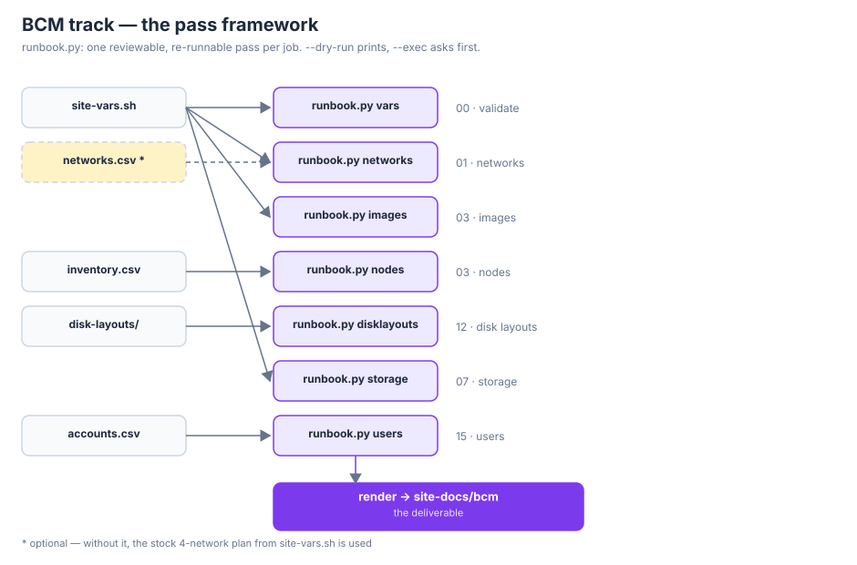
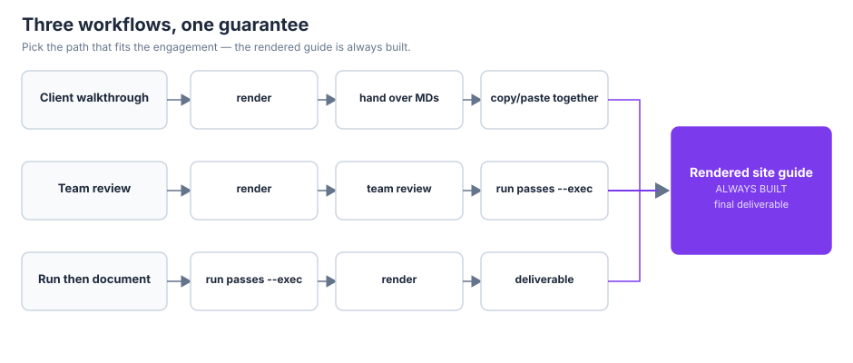
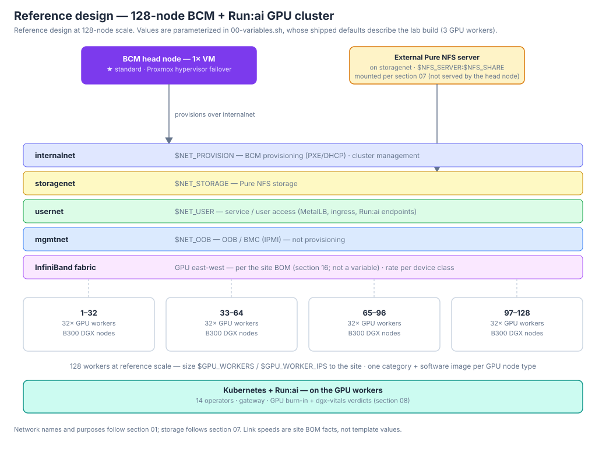
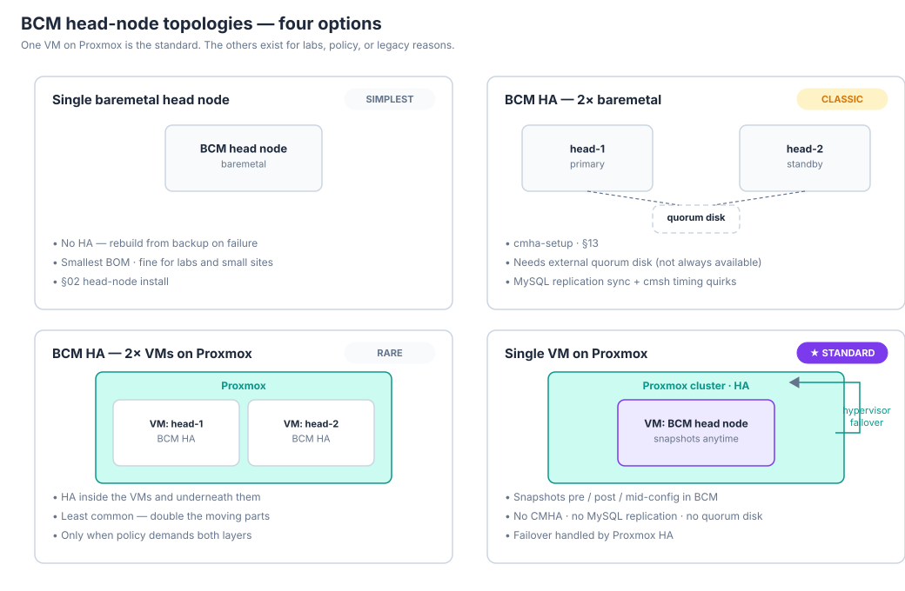

# B300 Deployment Runbook — Template

> An executable deployment recipe for BCM 11 + Kubernetes + NVIDIA Run:ai
> on DGX GPU nodes — the lab's canonical procedure, merged with the
> fixes discovered in the field, automation included.

`version 0.9.0` · `scripts/check.sh` green (publisher mode: exit 0 with the out-of-repo leak deny-list; without it the leak stage is NOT RUN and the gate exits 2) · `scripts/check.sh --site` green (every stage but the leak scan; exit 0/1) · Python 3.12 stdlib-only · anonymous by design

## Quickstart

```bash
# 1. Companyify: copy the pristine template to the site file, fill THAT in
cp 00-variables.sh site-vars.sh   # site-vars.sh is gitignored; never edit 00-variables.sh
nvim site-vars.sh && source site-vars.sh

# 2. Validate before anything else (every pass reads site-vars.sh; --vars FILE names another)
scripts/runbook.py vars          # fails: unfilled placeholders, empty DHCP_POOL, K8s CIDR overlap · reports: shipped defaults still in place
scripts/check.sh --site          # on site: every stage except the leak scan (exit 0 pass / 1 fail); CIDR guard reads site-vars.sh; cross-track IP guard runs when ../proxmox-ceph/site-vars.sh exists too
# scripts/check.sh               # publisher: every stage incl. the leak scan (needs the out-of-repo deny-list; exit 2 without it)

# 3. Run the deployment as composable passes (dry-run first, always)
scripts/runbook.py networks --dry-run
scripts/runbook.py images --dry-run
scripts/runbook.py nodes --inventory inventory.csv --dry-run
```

## The companyify flow

1. **Copy the template to the site file:** `cp 00-variables.sh
   site-vars.sh`. `00-variables.sh` is the pristine, tracked template —
   never edit it in place (a clone has a push remote; the site's values
   must not ride it). `site-vars.sh` sits beside it and is gitignored.
2. **Fill in `site-vars.sh`** — it's the only file that changes per
   deployment. Domain, networks, node names, IPs, credentials (as
   placeholder names), versions.
3. `source site-vars.sh` on the machine you're working from.
   Every `runbook.py` pass and `generate-nodes.py` read it by default
   (`--vars FILE` names another, before or after the pass name). With no
   site file they stop (exit 2); handed the template itself they refuse
   it (exit 2) — except `vars` and `render` named explicitly with
   `--vars 00-variables.sh`, the publisher's check, which say so.
4. **Work sections 01 → 16 in the run order** in `00-overview.md` (the
   library front door's cold-start path has it with time estimates), or
   run the matching `runbook.py` pass. Each section lists prerequisites
   at the top and ends with verification checkboxes. The run order in
   short: 14 (greenfield) first; 13 (HA) before 05; 16 (IB) and 15
   (users) any time after 03; 12 is the reference for 03.4.
5. Every `bash` block is copy-pasteable once the variables are sourced.
   Executable blocks carry no `<…>` placeholders (`check.sh` lints both
   upper- and lower-case ones). `UPPER_CASE` names come from
   `00-variables.sh`. Per-node values the file can't hold (a node's MAC,
   a discovered pod name) are shell variables you set first, and each
   use is written `${NAME:?…}`, so an unset value stops that command.
   Credentials are consumed as `bcm_require_secret NAME && …`.

## Automation: the pass framework

The end goal is one small, reviewable, re-runnable pass per runbook
section — each driven by data files instead of hand-typed commands.
**Re-runnable means add-or-verify:** a pass checks whether each object
exists, creates it only if it's absent, and aligns it either way. An
"already exists" is success-with-note, never an abort.
`--dry-run` is the default and prints exactly what would run; `--exec`
asks for confirmation first. Passes run on the BCM head node as root.



```
site-vars.sh ─────┬──▶ runbook.py vars         validate the variables file
                  ├──▶ runbook.py networks    01 · create/align BCM networks
                  ├──▶ runbook.py images      03 · categories + software images
disk-layouts/ ────▶├──▶ runbook.py disklayouts 03.4 · by-path XML → node, then category
inventory.csv ────▶├──▶ runbook.py nodes       03.5 · fleet gate (layoutgate), then provision from CSV
                  ├──▶ runbook.py storage     07 · NFS CSI driver + StorageClasses
accounts.csv ─────▶└──▶ runbook.py users       15 · BCM users + sudoers drop-in
```

| Pass | Runbook | Input | Does |
|---|---|---|---|
| `vars` | 00 | `site-vars.sh` (+ `networks.csv` beside it, or `--networks`) | **Fails** on a missing required variable (in a site file that includes `DHCP_POOL`, the 01 sign-off — it ships empty, so a site file fails until it is set; on the template it is a NOTE), an unfilled `<…>` placeholder, or a Kubernetes CIDR guard failure (the same guard as `check.sh`). **Reports, never fails:** every audited value still identical to the shipped template's default (`DOMAIN`, `CLIENT_ORG`, `NFS_SERVER`, `KERNEL_VER`, `BMC_USER`, every network/gateway/DNS/admin range, node and service IPs, the K8s ranges; also `DHCP_POOL`, `BCM_HA_VIP`, `HELM_VERSION`, `RUNAI_UTILS_COMMIT`, which ship empty and so are reported only once a template ships a default) — confirm each is really the site's. Credential-class names (`*PASSWORD*`, `*API_KEY*`, `*TOKEN*`, `*SECRET*`, `*PRODUCT_KEY*`, `*LICENSE_KEY*`) are excluded by policy from both: they stay placeholders and are reported as an excluded count. On the pristine template it exits 0 with the audit listing 27 of the 31 audited values (the four empty ones are not reported) |
| `networks` | 01 / 02.5 | variables or `networks.csv` | Creates/aligns BCM networks — **data-driven**: add rows to `networks.csv` (GPU east-west, IB, IPMI) with no code changes; `--networks` selects the file, otherwise the stock 4-network plan from variables. Dry-run in 01; `--exec` in 02.5 (refuses without `cmsh`) |
| `images` | 03 | variables | Creates categories, clones images (picks `dgx-image` vs `default-image` from `GPU_NODE_TYPE`), assigns images to categories |
| `disklayouts` | 03.4 (ref. 12) | `disk-layouts/<type>-by-path.xml` | Validates the XML (by-path only — refuses kernel names and by-id/uuid), applies it to the collection node (`--node`) or the category; stops with the collection procedure if the XML isn't built yet (it needs live hardware). `--type`/`--category` cover every host type. Logged override for a host type where by-path fails in the installer: `--allow-non-by-path --reason "…"` (loud warning every time, one line appended to `disk-layouts/OVERRIDES.log`; 03.4) |
| `layoutgate` | 03.4 | `--category`, `--device` (repeatable) | The fleet gate on its own, read-only: refuses unless each named category's `disksetup` in BCM — and each named device's device-level `disksetup`, where one is set — is by-path only; a category with no layout is a refusal. Honors the same override |
| `nodes` | 03.5 | inventory CSV | Validates (refuses an unfilled skeleton), then — under `--exec`, before anything is asked or run — applies the 03.4 fleet gate to every category in the inventory and to every existing node's device-level layout, and refuses unless each is by-path; then provisions every node. The generated `provision-nodes.sh` repeats the gate before its first `add`. Honors the same override |
| `storage` | 07 | variables | Installs/upgrades the NFS CSI driver, generates + applies StorageClasses on the variables-derived exports (`--plan 7a`: one default class, local-path un-defaulted, exactly-one-default verified; `--plan 7b`: data/scratch/models) |
| `users` | 15 | accounts CSV + passwords file | Creates BCM users (minimal `cmsh` form — extra switches cause OpenLDAP weirdness); refuses placeholder passwords; passwords reach `cmsh` on stdin, never argv; `--sudoers` emits the sudoers drop-in |
| `render` | — | variables | Builds the site-specific MD guide: copies every doc and substitutes the variables, **except credential-class names, which stay `$BMC_PASSWORD`-style references**. A credential holding a real value **in the variables file** (even as a `${NAME:-value}` default) makes render **refuse — exit 3, nothing written**; one held only in the environment is warned about by name and the render continues. Skips `99-role-mapping.md`, warns on unfilled placeholders |

### The three workflows



```
client walkthrough:   render -> hand the MDs over, copy/paste together
team review:          render -> review -> run the passes with --exec
run then document:    run the passes with --exec -> render as the deliverable
```

One guarantee across all three: **the rendered MD guide always gets
built.** It's a final deliverable — the first and last thing the
customer sees.

```bash
scripts/runbook.py render --out site-docs/bcm/     # reads site-vars.sh
# 23 docs -> site-docs/bcm/, every non-credential variable filled in, placeholders flagged;
# credentials stay as $BMC_PASSWORD-style references (a real value in the file: exit 3, nothing written)
```

The template docs are never modified; render writes a fresh directory
every time: an existing `--out` is refused, and `--force` replaces only a
directory a previous render wrote and that still matches that
render's JSON file manifest (`.bcm-manifest.json`) exactly — every
listed file present and unmodified, nothing extra, no symlinks —
never an arbitrary one. Links resolve inside the rendered guide: the
README's diagrams are copied into its `diagrams/`, links between
sections stay links, and links to library files that are not part of
the deliverable (the variables template, `99-role-mapping.md`) become
plain text naming the library path. The template stays pristine — the
site's truth lives in `site-vars.sh` + the three CSVs.

### Writing a new pass

1. Add a `pass_<name>(vars_, args)` function in `scripts/runbook.py` —
   build a command list, print it under `--dry-run`, run it under
   `--exec` via the `run_commands()` helper.
2. Register it in the subparsers (deployment order) and the dispatch
   dict at the bottom of `main()`.
3. Add any new inputs to `REQUIRED_VARS` so `runbook.py vars` catches
   them missing.
4. Add a smoke line to `scripts/check.sh` and a row to the table above.

Next candidates: `certs` (06), `k8s` (05, wrapping `cm-kubernetes-setup`
flags), `backup` (11).

## End result



What a completed build looks like at 128-node scale — a **reference
design**, not the template's defaults: the head node as a single VM on
Proxmox (the standard); NFS from the **external Pure NFS server on
`storagenet`** (`$NFS_SERVER`, mounted per 07 — the head node does not
serve it); provisioning on `internalnet`; `mgmtnet` for OOB/BMC;
128 B300 workers in four blocks of 32; Kubernetes + Run:ai on the
workers. The values are parameterized in `00-variables.sh` (copied to
`site-vars.sh`), whose shipped defaults describe the **lab build**
(3 GPU workers) — size `GPU_WORKERS`/`GPU_WORKER_IPS` and the networks
to the site. Link speeds and the InfiniBand fabric are not variables:
they come from the site's BOM (16 covers IB). 256-node layouts are a
future exercise (IP planning at that scale needs its own design pass).

### Head-node topologies



Four ways to deploy the head node. The standard is one VM on Proxmox:
snapshot before/after/during BCM config changes, and let Proxmox HA
handle failover — no `cmha-setup` (§13), no MySQL replication sync
quirks, no external quorum disk. BCM HA on baremetal is the classic
alternative when policy requires it; the other two cover labs and
edge cases.

## Sections

| # | File | What happens |
|---|---|---|
| — | [`00-overview.md`](00-overview.md) | How to use this template |
| — | [`00a-customer-inputs.md`](00a-customer-inputs.md) | What the site must provide before design closes |
| — | [`00b-recommended-specs.md`](00b-recommended-specs.md) | Design-time sizing — settled before 01 |
| — | [`00c-design-decisions.md`](00c-design-decisions.md) | The choices 01's sign-off ratifies |
| — | [`00d-design-assumptions.md`](00d-design-assumptions.md) | Register of what design takes on faith |
| — | [`00-variables.sh`](00-variables.sh) | **The pristine template** — copy to `site-vars.sh` (the companyify target) |
| 01 | [Environment & IP plan](01-environment-ip-plan.md) | Networks, DNS, inventory — get sign-off first |
| 02 | [BCM head node install](02-bcm-headnode-install.md) | ISO, licensing, upgrades, base config |
| 03 | [Images, categories, nodes](03-images-categories-nodes.md) | Software images, categories, provisioning, IPMI |
| 04 | [NVIDIA drivers](04-nvidia-drivers.md) | Driver install/repair inside images |
| 05 | [Kubernetes](05-kubernetes.md) | `cm-kubernetes-setup`, 14-operator set |
| 06 | [Run:ai](06-runai.md) | Certs, `cm-runai-setup`, gateway listeners, placement, backups |
| 07 | [Storage](07-storage.md) | Head-node NFS + CSI driver; **7A** simple / **7B** advanced plans |
| 08 | [Validation](08-validation.md) | GPU, platform, workload smoke tests |
| 09 | [NIM Operator](09-nim-operator.md) | NGC secrets, NIMCache, model validation |
| 10 | [Decisions & issues](10-decisions-issues.md) | Deviation log |
| 11 | [Backup, recovery, handoff](11-backup-recovery-handoff.md) | Backups, rollback, handoff checklist |
| 12 | [Disk layouts](12-disk-layouts.md) | by-path XMLs per DGX model |
| 13 | [BCM HA (optional)](13-bcm-ha.md) | `cmha-setup` — before 05 |
| 14 | [Greenfield infra](14-greenfield-infra.md) | Jumpbox, DNS, Chrony — before 01 |
| 15 | [User management](15-user-management.md) | BCM users from CSV, sudoers, image push |
| 16 | [InfiniBand / GPU fabric](16-infiniband.md) | OFED, subnet manager, IPoIB, fabric bandwidth check |
| 99 | [Role mapping](99-role-mapping.md) | Role → hostname/FQDN → IP naming pattern |

Delete `99-role-mapping.md` from an instantiated site copy — it
documents the template's role naming, not the deployment.

## Scripts

`scripts/` holds the table-driven tooling. Everything reads plain CSVs
you can build in a spreadsheet and export.

| Script | Purpose |
|---|---|
| `runbook.py` | **Pass runner** — composable sub-passes, one per runbook job (above) |
| `check.sh` | **Validate everything** — run after any edit, before any commit |
| `generate-nodes.py` | Node inventory CSV → `cmsh` provisioning script (dup-IP/MAC/hostname checks, `--skeleton` for fill-in sheets) |
| `generate-users.py` | Account CSV (`username,sudo`) → minimal `cmsh -q` user-creation script (dup-username checks); `--sudoers` emits the sudoers drop-in; `accounts-template.csv` is the fill-in starter |
| `networks-template.csv` | Fill-in starter for the data-driven `networks` pass |

## Anonymizer pack (optional)

`anonymizer-pack.tar.gz` (separate download) is the companion tool for
scrubbing a *source* bundle — raw client docs, the bundle export — before
they leave your laptop. Four passes, stdlib-only, no network, no LLM:

1. **Client names** → stand-in (`--replacement`, default `Wayland Megacorp`)
2. **Networks** → sequential doc ranges (`10.10.11.0/24`, …; host octets preserved)
3. **InfiniBand** → `<ib-guid-001>` etc.
4. **Hostnames** → `node-001.example.internal`, … (explicit `--domains` list)

It re-scans its own output and prints `LEAK` lines for anything that
survived. Always `--dry-run` first.

```bash
tar -xzf anonymizer-pack.tar.gz && cd anonymizer-pack
BUNDLE_DIR=/path/to/source-bundle   # the bundle export to scrub
./anonymize.py --client "Acme Widgets" --domains "acme.com" --scan "$BUNDLE_DIR" | nvim -
./anonymize.py --client "Acme Widgets" --domains "acme.com" --dry-run "$BUNDLE_DIR" | nvim -
./anonymize.py --client "Acme Widgets" --domains "acme.com" --out "$BUNDLE_DIR-anon" "$BUNDLE_DIR"
```

Use `--client-file names.txt` (one per line) so real customer names never
land in shell history.

### Leak scan (`check.sh`)

The ongoing guard is the `check.sh` leak scan. It reads a **deny-list
kept outside the repo** — path from the `MIMIRS_DENYLIST` environment
variable, default `~/.config/mimirs-manual/leak-denylist.txt` — so the
library never ships the identifiers it hunts. One pattern per line (Python regex, matched
case-insensitively); blank lines and full-line `#` comments are ignored.
It scans the **whole repo** (both tracks, docs, READMEs, the companion;
`.git` excluded), including the text and metadata inside `.docx` files
and the metadata of the `.pdf`; it lists the files it can only partly
see (PDF body text, images). A deny-list that is missing or has no
patterns makes the stage report **NOT RUN** and `check.sh` exit 2 —
never a pass. Untracked site files sitting in the tree (an
`inventory.csv`, say) are scanned too, so run it on a clean copy. Git
history is not scanned.

## Requirements

- **Python 3.12** — stock on Ubuntu 24.04, which is what DGX OS and the
  BCM head node are based on. No pip packages needed for the passes and
  generators: they are standard library only (`csv`, `argparse`,
  `ipaddress`, `re`, `subprocess`). Verify: `python3 --version`
- **`scripts/check.sh` only:** PyYAML for its YAML stage (`python3-yaml`
  on Ubuntu/Debian). Without it that stage fails with a message naming
  the package — the gate does not pass what it could not check.
- `cmsh` passes run **on the BCM head node** as root.
- `bash`, standard coreutils.

## Conventions

- `bash` blocks run on the BCM head node unless labeled otherwise.
- Field notes (`> **Field note**`) mark where the client deployment
  diverged from the lab procedure — read them.
- `[restored]` marks lab procedures the client docs had dropped.
- Credentials are always placeholders in the template and every
  deliverable, never real values. Credential class: `*PASSWORD*`,
  `*API_KEY*`, `*TOKEN*`, `*SECRET*`, `*PRODUCT_KEY*`, `*LICENSE_KEY*`.
  `render` never substitutes them (the guide keeps the `$BMC_PASSWORD`-style reference), and it
  warns loudly if one holds a real value. The operator's shell supplies
  them at run time (`read -rs NAME; export NAME`).
