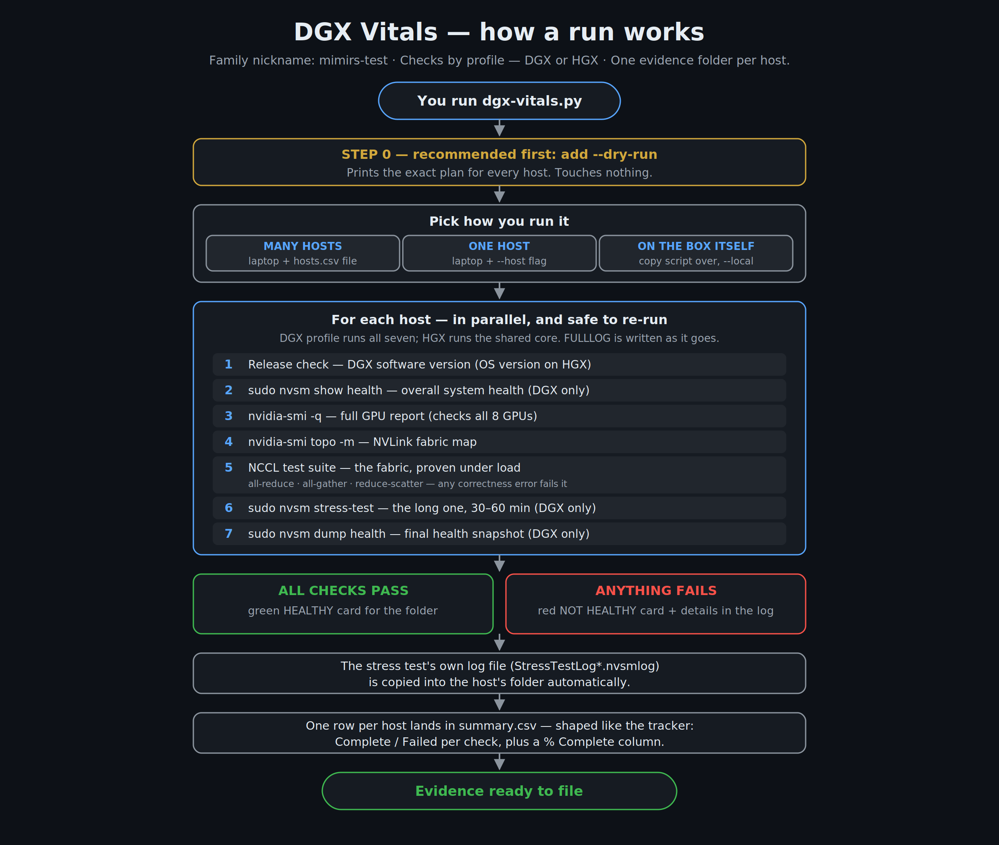
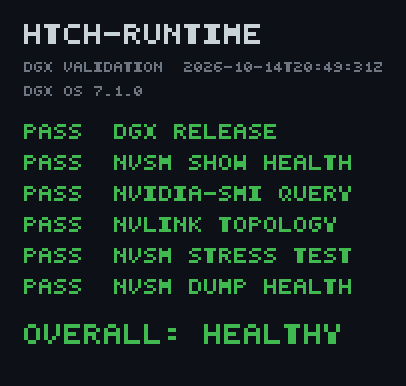
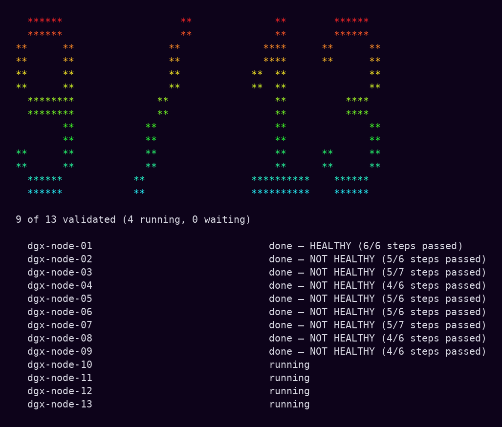
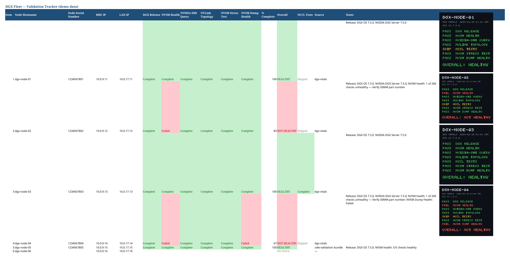

# DGX Vitals

*Family nickname: **mimirs-test** — the Mimir family's validation runner.*

**Takes a DGX's vitals.** One script runs the standard DGX validation
checks on one machine — or a whole fleet over SSH — and files the evidence
for you: a full log, a health card, and a tracker-ready summary. No manual
SSH sessions, no screenshots, no typing results into a spreadsheet.



## Getting DGX Vitals

**If you're comfortable with GitHub** — clone the repo (same name on the
work account):

```
gh repo clone altonhill/dgx-vitals
```

—or with plain git:

```
git clone https://github.com/altonhill/dgx-vitals.git
```

**If you'd rather not touch GitHub at all** — one command downloads the
whole thing as a zip:

```
curl -L -o dgx-vitals.zip https://github.com/altonhill/dgx-vitals/archive/refs/heads/main.zip
```

On Windows, run that in PowerShell exactly as written (Windows ships
`curl.exe`). Then unpack it — `Expand-Archive dgx-vitals.zip` in
PowerShell, `unzip dgx-vitals.zip` on Mac/Linux, or just right-click →
Extract All — and work inside the `dgx-vitals-main` folder it creates.

Either way, you end up with a folder containing `dgx-vitals.py`. That
script plus your `hosts.csv` (next section) is all you need.

## What you get

For every host, a folder with:

- **`<hostname>-FULLLOG.txt`** — everything the checks printed, word for word
- **`<hostname>-HEALTHY.png`** — the health card (green = healthy, red = not)
- **`StressTestLog*.nvsmlog`** — the stress test's own log file, when it writes one

Plus one **`summary.csv`** for the whole run — one row per host, with a
Complete / Failed cell per check and a % Complete column, shaped to paste
straight into the install tracker.



## The checks

Which checks run depends on the **profile** — `--profile dgx` (the
default) or `--profile hgx`:

| # | Check | What it does | DGX | HGX |
|---|-------|--------------|:---:|:---:|
| 1 | Release | DGX software version (plain OS version on HGX) | ✓ | ✓ |
| 2 | NVSM Show Health | Overall system health report | ✓ | — |
| 3 | NVIDIA-SMI Query | Full GPU report — verifies all GPUs are present | ✓ | ✓ |
| 4 | NVLink Topology | Maps the NVLink fabric between GPUs | ✓ | ✓ |
| 5 | NCCL Tests | Runs NVIDIA's NCCL test suite across all GPUs — the fabric, proven under load. Fails on any correctness error | ✓ | ✓ |
| 6 | NVSM Stress Test | Stresses the system (this is the long one — 30 to 60 minutes) | ✓ | — |
| 7 | NVSM Dump Health | Final health snapshot | ✓ | — |

NVSM is DGX-only software, so on HGX systems the NCCL run carries the
fabric proof. The NCCL step runs a small suite — **all-reduce,
all-gather, reduce-scatter** (the collectives real training traffic is
made of) — and reports peak bus bandwidth per test. It needs MPI and
the NCCL tests provisioned on the host (the `*_perf` binaries on the
PATH, or `--nccl-dir` pointing at them); if they're missing, the step
says so plainly instead of failing mysteriously. Choose a different
suite with `--nccl-tests all_reduce` and friends.

## Before you start

You need three things:

1. **Python 3** on your laptop (instructions per system below — it's a
   one-time, five-minute install).
2. **The script and a hosts file** in the same folder: `dgx-vitals.py`
   and your `hosts.csv`. The hosts file is one machine per line, in any
   of these shapes — `hostname,address,user`, just `hostname,address`,
   just a hostname, or just an IP. The header row is optional. The
   hostname is the name used for the evidence folder; the address is the
   IP (or tailnet name) the tool connects to. See `hosts.example.csv`.
3. **SSH access** to the DGX machines with a key set up (the same access
   you'd use to log in by hand). If you can already SSH to the boxes,
   you're set.

Nothing else to install — the script uses only Python's built-in parts.

---

## Windows

1. **Install Python:** go to [python.org/downloads](https://www.python.org/downloads/),
   run the installer, and on the first screen **tick "Add python.exe to
   PATH"** before clicking Install.
2. Open the folder that contains `dgx-vitals.py` and your `hosts.csv`.
   Click the address bar in File Explorer, type `powershell`, press Enter —
   a PowerShell window opens already in that folder.
3. **Dry run first** (shows the plan, touches nothing):

   ```
   py dgx-vitals.py --hosts hosts.csv --out Results --dry-run
   ```
4. When the plan looks right, run it for real — same command, minus
   `--dry-run`:

   ```
   py dgx-vitals.py --hosts hosts.csv --out Results
   ```
5. Results land in the `Results` folder. The last line tells you where
   `summary.csv` is and flags any machine that came back **NOT HEALTHY**.

## Mac

1. **Python:** macOS may already have it. Open Terminal (Spotlight →
   "Terminal") and type `python3 --version`. If a version prints, you're
   set; if a pop-up offers developer tools, click Install and wait for it
   to finish. (Or install Python from python.org.)
2. In Terminal, go to the folder with the script — type `cd ` (with a
   space), drag the folder from Finder into the Terminal window, press
   Enter.
3. **Dry run first:**

   ```
   python3 dgx-vitals.py --hosts hosts.csv --out Results --dry-run
   ```
4. Then the real run:

   ```
   python3 dgx-vitals.py --hosts hosts.csv --out Results
   ```

## Linux

1. Python 3 is almost certainly already there: `python3 --version`.
2. In the folder with the script:

   ```
   python3 dgx-vitals.py --hosts hosts.csv --out Results --dry-run
   python3 dgx-vitals.py --hosts hosts.csv --out Results
   ```

---

## Other ways to run it

**Just one machine** (no hosts file):

```
py dgx-vitals.py --host dgx-node-01 --address 10.0.0.51 --user ubuntu --out Results
```

**Right on the DGX itself** (copy the script to the box first):

```
python3 dgx-vitals.py --local --out Results
```

**Interrupted?** Just run the same command again. Hosts that already have
a finished log are skipped; the run picks up where it left off. Add
`--force` only if you truly want to redo finished hosts.

## Handy options

| Option | What it does |
|--------|--------------|
| `--dry-run` | Print the plan and sample output — touches nothing |
| `--jobs 8` | Check 8 hosts at a time (default 4) |
| `--only stress` | Run just one check (handy for a stress-test redo) |
| `--tail` | Watch each step's output on screen as it happens (best for one host or a few) |
| `--sudo-password` | Ask for the hosts' sudo password once, if they need one |
| `--stress-timeout 5400` | How long the stress test may run, in seconds (default fits a 60-minute test) |
| `--health-timeout 1800` | Time limit for NVSM Show Health, in seconds (it can take 15–20) |
| `--dump-timeout 1800` | Time limit for NVSM Dump Health, in seconds |
| `--force` | Redo hosts that already finished |
| `--profile hgx` | HGX systems: NCCL + nvidia-smi checks only (no NVSM) |
| `--nccl-min-busbw 400` | Also fail the NCCL check if peak bus bandwidth is under this many GB/s (default: correctness only) |
| `--nccl-dir /path/to/tests` | Folder holding the `*_perf` binaries, if they aren't on the PATH |
| `--nccl-tests all_reduce` | Run a different NCCL suite (default: all_reduce, all_gather, reduce_scatter) |

## If something goes wrong

| What you see | What it means / what to do |
|--------------|----------------------------|
| `'py' is not recognized` (Windows) | Python isn't on the PATH. Re-run the python.org installer and tick **"Add python.exe to PATH."** |
| `Permission denied (publickey)` | Your SSH key isn't accepted on that host yet. If you can't SSH in by hand either, sort that first — the tool uses the same access. |
| Steps 2, 5, or 6 fail instantly | Those need sudo. If the account has a sudo password, add `--sudo-password` and type it once when asked. |
| A host comes back NOT HEALTHY | Open that host's FULLLOG — the failing check and its full output are in there. The card tells you *that* it failed; the log tells you *why*. |
| The run got cut off mid-way | Re-run the same command. Finished hosts are skipped automatically. |

## Notes for maintainers

- PASS rules are deliberately simple (clean exit codes, all expected GPUs
  present, no *unhealthy / critical / fatal* in the health report). They
  live in one function — `verdict()` in `dgx-vitals.py` — and the FULLLOG
  always keeps the raw output, so a human can override any verdict.
- Targets are Ubuntu 24.04 / DGX OS. The stress-test log harvest looks in
  `$HOME`, `/var/log`, and `/tmp` for `*.nvsmlog` files created during the
  run.
- The stress step runs `nvsm stress-test --no-prompt`, and the verdict
  fails any run whose output shows the confirmation prompt: without the
  flag, nvsm prompts, reads EOF over SSH and exits 0 having run nothing.
  (Found on the first real-hardware run, 2026-11-11 — the PASS was hollow.)
  The verdict also fails a run that finds a stress test already in
  progress on the host (nvsm cancels the new request and exits 0): the
  stress itself runs service-side and survives client disconnects, so a
  leftover from an earlier run is a real field case, not a pass.
- NCCL is a dgx-vitals addition beyond the original field workflow: when
  nccl-tests is not installed on a host, the step is SKIPPED — excluded
  from % Complete and the Overall verdict — not failed. Where NCCL is
  contractual, pass `--require-nccl`: a missing install then FAILs the
  step instead of skipping it.
- `--profile auto` probes each host once before running: /etc/dgx-release
  or the nvsm CLI means dgx, neither means hgx, and the host's step list
  is built to match (a mixed fleet validates in one batch). The detected
  platform and the host's DMI product/vendor are recorded in the FULLLOG
  header. An explicit `--profile dgx|hgx` still overrides per run.
- `--watch --hosts wave.csv --out ROOT` is the wave scoreboard: it
  contacts nothing and reads the output root — a host counts as done
  when its health card exists (or its FULLLOG shows the OVERALL
  trailer). It renders the count in doubled block letters, rainbow on a
  TTY, with per-host state below, and closes with a WAVE DONE banner
  and the verdict tally when the wave completes. `--once` prints a
  single plain-text look for scripts.
- `nvsm dump health` gets a 3600s default timeout: on a B300 it sat at
  99% past the old 1800s cap. The dump archive it writes is harvested
  into the host's output folder alongside the stress log.
- **v1.8 — stress refusals + `--force-stress`.** Field lesson from the
  first fleet wave: `nvsm stress-test` refuses to run while system
  alerts are uncleared ("Stress Testing will not be done") and exits 0;
  a word-scan read that refusal as a failure. A refusal is now scored
  SKIP — the step did not run — and `--force-stress` passes nvsm's own
  `--force` for re-runs where the alerts are known and adjudicated.

## Building the tracker sheet — `tracker_build.py`

After a batch run, turn the output root into a tracker-shaped spreadsheet —
one row per host, the per-test columns filled in, each host's health card
embedded in its row:

    python3 tracker_build.py --vitals validation-output --hosts hosts.csv \
        --out validation-tracker.xlsx

It can also fold in harvested `cdw-validation` bundles (`--bundles DIR`) for
hosts validated outside dgx-vitals — dgx-vitals wins where both exist, and
the Source column always says which pipeline produced a row. A bundle's
NVSM Health is judged from the health log's Unhealthy checks, not the exit
code (`nvsm show health` exits 0 with unhealthy checks present). The fleet
CSV supplies row order and the BMC/LAN IP columns; hosts with no results
still get a NO DATA row, so the sheet doubles as a checklist. `--bundle-out
FILE.tar.gz` packs the sheet plus every source artifact into one
sha256-stamped bundle for ferrying to another machine. Needs
`pip install openpyxl pillow` — dgx-vitals itself stays stdlib-only.

**Adjudications (tracker_build v1.3).** Known false positives are ruled,
not deleted and not left red. When a host's only unhealthy NVSM check
is `Verify DIMM part number` (KI-1 — NVSM's expected-parts list lags
the fleet's fitted Micron part), NVSM Health is marked **Warned**, and
a host with no other failures reads **HEALTHY WITH WARNINGS**. When
NCCL failed only because nccl-tests is partially provisioned (KI-2),
it is marked Skipped — not tested — instead of Failed. One-off rulings
go in a CSV (`--adjudications`, columns `hostname,step,state,note`).
Every ruling is written up in a Known Issues & Adjudications block at
the bottom of the sheet. Multiple `--vitals` roots merge **per step**,
so a partial re-run (`--only dump`) overrides only the steps it ran.

## Screenshots

The wave scoreboard (`--watch`), mid-wave — demo data:



The consolidated tracker built by tracker_build.py — demo data, with the
per-host health cards embedded:


