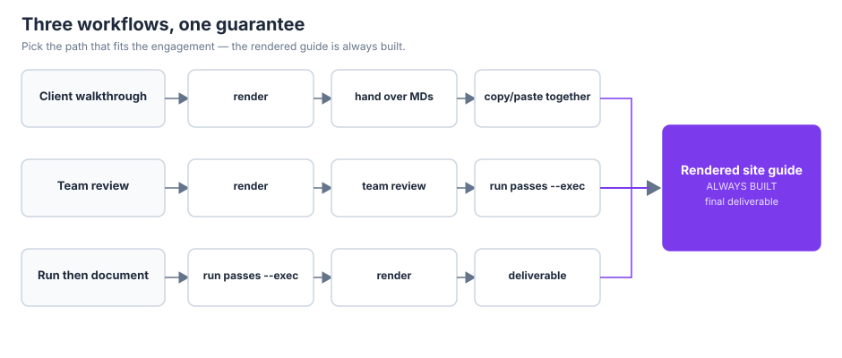
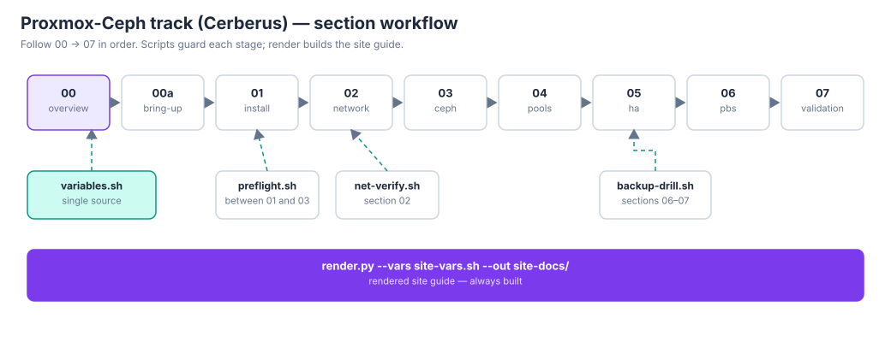
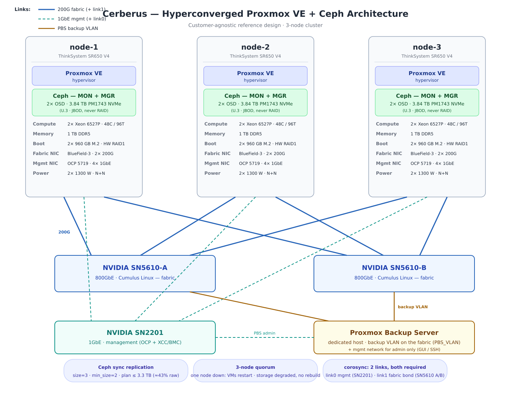

# Cerberus

The reusable hyperconverged **Proxmox VE + Ceph** runbook — three nodes standing guard.

## What this is

A customer-agnostic, step-by-step runbook for designing, building, and validating a
hyperconverged Proxmox VE + Ceph cluster (3 nodes, 4th optional): synchronous
replication, Proxmox Backup Server, HA, and failure testing. Built from real
deployment work and anonymized throughout (role-based names only), so it can be
reused for any customer — and for the lab.

## Status

Complete. The full step-by-step runbook lives under `runbook/` (00-overview
through 07-validation, plus 00a physical bring-up), with guarded scripts in
`scripts/` and the customer-facing briefs in `docs/`. The locked-in decisions,
hardware baseline, and original open questions are preserved in
[docs/runbook-starting-point.md](docs/runbook-starting-point.md).

## Quickstart

```bash
# 1. Companyify: copy the variables file per site, fill in every value
cp runbook/00-overview/variables.sh site-vars.sh
nvim site-vars.sh          # replace every PLACEHOLDER *and* every template default

# 2. Validate the track — green = exit 0 (doc-block bash -n, placeholder
#    lint, paste-atomicity lint, render smoke + credential tripwire)
scripts/check.sh

# 3. Render the site-specific guide (see below), then follow it 00 -> 07
scripts/render.py --vars site-vars.sh --out site-docs/
```

## The three workflows



**1. Client walkthrough** — they copy/paste, you guide:
```bash
scripts/render.py --vars site-vars.sh --out client-docs/
# hand over client-docs/; walk through it together, copy/paste per section
```

**2. Team review, then build:**
```bash
scripts/render.py --vars site-vars.sh --out review-docs/   # team reviews this
# ...after sign-off, on the nodes (preflight runs after 01, before 03):
scripts/preflight.sh       # reads site-vars.sh at the track root; --vars FILE names another
# ...then follow runbook/ 00 -> 07
```

**3. Build first, document after** (the favorite):
```bash
# on the nodes, just build it (preflight runs after 01, before 03):
scripts/preflight.sh       # reads site-vars.sh at the track root; --vars FILE names another
# ...follow runbook/ 00 -> 07...
# ...when the build is done, the deliverable:
scripts/render.py --vars site-vars.sh --out final-docs/
```

One guarantee across all three: **the rendered guide always gets built.**
It's a final deliverable — the first and last thing the customer sees.

The template docs are never modified; render writes a fresh directory every
time. The template stays pristine — the site's truth lives in your
`site-vars.sh`. Only variables defined in `variables.sh` are substituted,
and never with an empty string; shell loop variables inside the docs (e.g.
`${NODE_NUM}`, set per-node at deploy time) and the host-resolved interface
names (`BF3_P1`, `BF3_P2`, `MGMT_IF`, undefined in the template on purpose)
are left untouched. The render report lists what still needs attention:
values still literally `PLACEHOLDER`; names defined but empty (passed through
as `$VAR`, never blanked); and every audited value — networks, gateways,
IPs, the PBS host, DNS, NTP, the mail target (`MAILTO`), the pool sizing
(`POOL_VM_TARGET_SIZE`, `POOL_VM_QUOTA_BYTES`), the XCC login name — still
identical to the template's shipped default. It reports; it does not stop
the render. `cerberus_audit_placeholders` (defined in the variables file)
runs the same audit in a node shell.

**Credentials never appear in a deliverable, placeholder or real.** Any name
matching `*PASSWORD*`, `*API_KEY*`, `*TOKEN*`, `*SECRET*`, `*PRODUCT_KEY*` or
`*LICENSE_KEY*` is never substituted: the rendered guide keeps `$NAME` for
the operator's shell, and every render lists the kept names. If such a name
holds a live value **in the variables file**, render refuses (exit 3) and
writes nothing; if it is live only in the environment (the sanctioned
pattern: `read -rs PBS_PASSWORD; export PBS_PASSWORD`), render warns by name
and continues. The PBS token secret (§06.5) lives in the site's secrets
vault — never in `site-vars.sh`. At run time, `cerberus_require_secret NAME`
refuses an unset or placeholder secret (names only, never values).

The node scripts (`preflight.sh`, `net-verify.sh`, `backup-drill.sh`) take
`--vars FILE` like `render.py`; without it they read `site-vars.sh` at the
track root, and if neither exists they stop. They never fall back to the
template's defaults.

## Working-directory contract (read before pasting anything)

The runbook's commands run **on the nodes** (and the PBS host), from a copy
of this repository. They find the site file through one variable, not
through the current directory:

```bash
# Once per host (each node, and the PBS host): put the repo copy where the
# site keeps it — /root/mimirs-manual is the convention — then:
grep -qs '^export CERBERUS_TRACK=' /root/.bashrc \
  || echo 'export CERBERUS_TRACK=/root/mimirs-manual/proxmox-ceph' >> /root/.bashrc
export CERBERUS_TRACK=/root/mimirs-manual/proxmox-ceph
test -f "$CERBERUS_TRACK/site-vars.sh" && echo "site file OK"
```

Every state-changing block in the runbook is pasted as one **fail-closed
unit**:

```text
( set -euo pipefail
  source "${CERBERUS_TRACK:?export CERBERUS_TRACK=... first}/site-vars.sh"
  ...commands...
)
```

Bash reads the whole `( … )` before running any of it, and the first
failure — a guard, an unset variable, a failed write — stops the block. The
operator's own shell survives (an `exit` inside the parentheses leaves only
the subshell). A block that does not start with `(` either changes nothing
(a check you read) or deliberately sets up your shell for the next block
(marked `# paste: session`). `scripts/check.sh` enforces this: a block that
sources the site file or calls a `cerberus_require_*` guard outside the
idiom, or sources the site file by a relative path, fails the gate. The
per-node interface names live in `/root/cerberus-node.env` (written in
§02 §1), so a second SSH session or the XCC console has them too.

## Section workflow



Follow the sections 00 → 07 in order (00a physical bring-up first on
baremetal). The scripts guard each stage: `preflight.sh` after the 01
install and before Ceph (03), `net-verify.sh` after the network build, `backup-drill.sh`
around the PBS work — and `render.py` turns the whole thing into the
site's deliverable.

## End result



Three ThinkSystem SR650 V4 nodes, hyperconverged: Proxmox VE cluster on
top, Ceph Tentacle underneath (MON/MGR/OSD per node, size=3/min_size=2),
HA with hardware watchdog fencing, Proxmox Backup Server on its
dedicated host, and a validation section that proves it by breaking
things on purpose.

## Layout

- `docs/runbook-starting-point.md` — design decisions, hardware baseline, open questions, section outline
- `docs/site-profile-flat.md` — how the template instantiates on a flat IP plan (one mgmt /24, per-role data /24s): Ceph addressing variant, PBS host rule, Netris bootstrap, phased bring-up
- `docs/customer-design-brief.md` (+ `.docx`, `.pdf`) — customer-facing design brief: architecture, specs, protection story
- `docs/customer-protection-brief.md` — one-page "you are protected" high points
- `docs/references.md` — curated official documentation links per runbook section
- `docs/diagrams/` — architecture.svg/png and cable-diagram.svg/png (generated programmatically)
- `runbook/` — the full step-by-step (one directory per section)
- `scripts/` — idempotent, guarded automation (preflight checks, `--dry-run`, confirmations);
  `render.py` builds the site-specific Markdown guide, `check.sh` is the validation gate
  (green = exit 0)

## Conventions

- **Customer-anonymized:** role-based node names (`node-1`, `node-2`, `node-3`), no customer
  identifiers anywhere; credentials never in the repo or a rendered guide — read at run time.
- **Variables-first:** per-site values go in `site-vars.sh` (a copy of the pristine
  template `runbook/00-overview/variables.sh`, kept at the track root); everything
  else is copy-paste.
- **Baremetal-up:** no vendor integration kit assumed — the runbook owns physical bring-up
  verification (section `00a`) through final validation.
