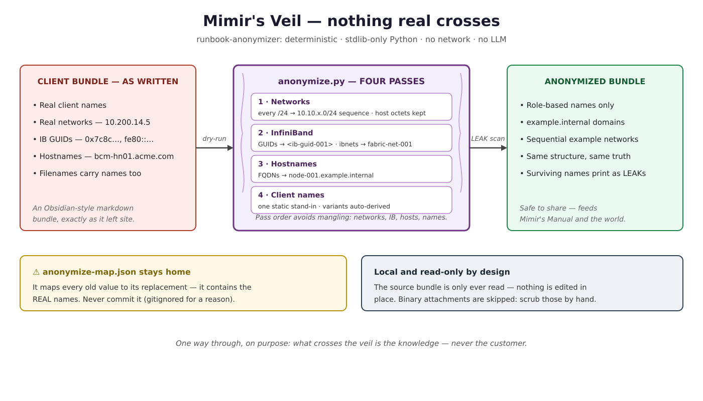

# runbook-anonymizer

Anonymize an Obsidian-style markdown bundle (BCM, Kubernetes, RunAI, ...)
before it leaves your laptop. Stdlib-only Python — no dependencies, no
network, no LLM. Read `anonymize.py` before running it; it's meant to be
read.



## Quickstart

```bash
# 1. point it at the bundle, see what it would do (no changes)
./anonymize.py --client "Acme Widgets" --domains "acme.com, acmewidgets.internal" --scan ~/obsidian/bcm-bundle | nvim -

# 2. dry-run the full diff
./anonymize.py --client "Acme Widgets" --domains "acme.com, acmewidgets.internal" --dry-run ~/obsidian/bcm-bundle | nvim -

# 3. write the anonymized bundle (exit 0 = clean; anything else = do not publish)
./anonymize.py --client "Acme Widgets" --domains "acme.com, acmewidgets.internal" --out ~/bcm-bundle-anon ~/obsidian/bcm-bundle
```

`--client` is repeatable and accepts comma-delimited lists
(`--client "Acme, Globex"`). Prefer `--client-file names.txt` (one name per
line, `#` comments allowed, indented ones too) so real customer names never
land in shell history — and it's the way to pass a name containing a
literal comma. An `--out` run **requires** at least one client name.

## What gets detected, and where

Every detector runs over file **contents and relative file paths** — an
identifier that appears only in a filename is collected and replaced like
any other. Replacement is **one combined pass**: nothing one class inserts
is ever re-matched by another, so stand-ins never nest or get mangled.

The passes, in priority order (at any position, the first class that
matches wins — this is the real order in the code):

1. **Hostnames** — explicit-list driven: only FQDNs under `--domains`
   (repeatable, comma-delimited, or `--domain-file`) are anonymized.
   FQDNs with a host part become `node-001.example.internal`,
   `node-002.example.internal`, ...; a listed domain itself (`bhicorp.com`)
   collapses to the generic domain (`example.internal`), as does any kept
   FQDN that is the parent domain of other kept FQDNs (e.g.
   `acl.eng.cdwbuilt.com` above `acl-bcm-hn01.acl.eng.cdwbuilt.com`).
   - Host identity is case-insensitive: `HN01.ACME.COM` and
     `hn01.acme.com` are one node.
   - Labels may contain underscores (`acl_bcm_hn01.acme.com`;
     `_ldap._tcp.host.acme.com` keeps its SRV prefix).
   - A listed domain wins over a file-extension-looking last label
     (`hub.acme.sh` under `--domains acme.sh`), and a listed domain buried
     mid-token is still caught (`hn01.acme.com.prod`).
   - Bare hostnames are auto-derived from anonymized FQDNs — a bare
     `acl-bcm-hn01` in `cmsh` commands maps to the same node as its FQDN
     (disable with `--no-derive-bare`). They are also caught via
     `--host-pattern` regexes (e.g. `--host-pattern 'bcm-[a-z0-9-]+'`),
     `user@host` contexts, and `ssh`/`scp`/`mosh`/`ping` targets: options
     and their values are skipped (`ssh -i id_rsa hn01` → the host is
     `hn01`, never `id_rsa`), and for `scp` only `host:path` /
     `user@host` arguments are hosts (`scp backup hn04:/tmp/` → `hn04`).
   - A bare name followed by `.label…` is left to the FQDN pass only when
     what follows ends like a domain — a two-letter or well-known TLD such
     as `.com`/`.internal`, and not just file extensions (`www.github.com`
     and `dbx.log.globex.com` stay intact while a standalone `www` still
     maps). Anything else is a filename, and the bare host is scrubbed
     whatever the extension: `hn01.md` → `node-001.md`,
     `hn01.docx` → `node-001.docx`, `hn01.backup.xlsx` →
     `node-001.backup.xlsx`.
   - Everything else — Kubernetes field paths (`spec.containers`), Helm
     values (`nfd.enabled`), `cluster.local`, public vendor domains — is
     left alone by design — except a domain carrying the client's own
     name (`dbx.log.globex.com` with `--client Globex`): it is listed
     automatically (`--scan` tags it `auto`), so the whole host is
     anonymized instead of split-mangled. Because forgetting a client domain is the
     biggest real-world risk, `--scan` lists every non-listed domain it
     saw: read that list.
2. **InfiniBand and hardware IDs** — GUIDs (`0x...`) and GIDs (`fe80::...`
   forms, and full 8-group colon forms such as `de:ad:be:ef:00:11:22:33`)
   become `<ib-guid-001>` etc.; **MAC addresses** (6-group hex, colon
   `aa:bb:cc:dd:ee:ff` or dash `AA-BB-CC-DD-EE-FF` form — one MAC is one
   placeholder whichever separator it is written with) become
   `<mac-addr-001>` etc. with their own map section (keyed in colon form); `ibnet*` fabric names become `fabric-net-001` etc. (standard
   tools — `ibnetdiscover`, `ibnetinfo`, `ibnetfind`, `ibnetstat`,
   `ibnetwatch`, `ibnetping`, `ibnetcount` — are left alone). IDs are
   case-insensitive (one device, one ID). Shorter colon strings such as
   `12:34:56:78` are not IDs and are left alone. Bare `ib0`/`ib1` interface
   names are left as-is (generic Linux names) and counted in the summary.
3. **Networks** — every distinct IPv4 /24 found is remapped to a
   sequential range: `10.10.11.0/24`, `10.10.12.0/24`, ..., skipping any
   range the bundle itself uses. Host octets are preserved
   (`10.200.14.5` -> `10.10.11.5`). Leading zeros are normalized —
   `010.200.014.005` is the same address as `10.200.14.5`, maps the same
   way, and never keeps a leading zero in the output. CIDR suffixes are
   kept. **Reverse-DNS names** map through the same net map, so they stay
   paired with their forward address: with `10.200.14.5` -> `10.10.11.5`,
   `5.14.200.10.in-addr.arpa` -> `5.11.10.10.in-addr.arpa` (a /24 zone
   `14.200.10.in-addr.arpa` likewise). A net that appears only in reverse
   form is still collected and mapped, and the re-scan flags any real
   address surviving in reversed form. Loopback, link-local, multicast,
   `0.0.0.0` and netmasks are left alone. Tune with
   `--net-base` / `--net-start`.
4. **Client names** — case-insensitive, replaced with a static stand-in
   (`--replacement`, default `Wayland Megacorp`). The words of a name may
   be joined by any whitespace run (line breaks and tabs included),
   hyphens, underscores, punctuation or nothing: `Acme Widgets`,
   `Acme`⏎`Widgets`, `acme-widgets`, `acme_widgets`, `AcmeWidgets` all
   match. The **first and last word** of a multi-word name also match
   **alone** (`At Acme we…`, `Acme's datacenter`, `the Widgets team`),
   except words shorter than 3 characters, generic corporate suffixes
   (`Corp`, `Inc`, `LLC`, `Ltd`, `Group`, …) and common English words
   (`The`, `One`, `New`, …), and a word matched alone never matches
   inside a larger word (`renew` is not `New`); the map lists them under
   `client_words_matched_alone`. A client name — or a word of it matched
   alone — that would match inside the tool's own vocabulary (the
   stand-in, the host prefix, the generic domain, `fabric-net`,
   `ib-guid`, `mac-addr`, the net base) is refused up front, naming the
   collision.

## The re-scan, and exit codes

After anonymizing, every output text, every output filename and every
file copied without scrubbing is re-scanned for every real value collected
(client names, hostnames/FQDNs, IPs, GUIDs, MACs, ibnet names). For an
`--out` run the scan covers everything in the output directory, including
files a previous run left there. Each survivor prints a `LEAK` line on
stderr (file, value class, line context) and the run exits non-zero.

| exit | meaning |
|---|---|
| 0 | clean |
| 1 | no input files, or an anonymized-filename collision (nothing written; `--scan` reports it too) |
| 2 | usage error, or refused by a guard: `--out` is/inside an input, no client names for `--out`, client/vocabulary collision, a pre-existing output file differs, `--map` inside `--out`, default map path holds a different run's map |
| 3 | `LEAK` survivors found — do not publish |

## Warnings

- `anonymize-map.json` maps every old value to its replacement — **it
  contains the real names. Never commit it.** By default it is written
  **next to** the output directory (`<parent-of-out>/anonymize-map.json`),
  never inside it; the stderr line states the exact path written. `--map`
  overrides (but may not point inside `--out`). Same goes for your
  client-file.
- Files that cannot be scrubbed — binary suffixes (images, PDFs, archives),
  anything that isn't valid UTF-8, and anything containing NUL bytes
  (UTF-16 without a BOM is valid UTF-8 byte-wise but can't be scrubbed) —
  are **copied verbatim** under their anonymized filename and listed in
  the **"copied WITHOUT scrubbing"** manifest at the end of every run (and
  in `--scan`). Their contents are still read for detection (as latin-1,
  and NUL-stripped), so an identifier that appears only in such a file is
  collected and the re-scan flags the file (exit 3). Scrub every file in
  that manifest by hand; the re-scan cannot see inside compressed or
  encoded content. `.git` directories are never read or copied.
- `--scan` and `--dry-run` exist so you can verify before writing. Use them.
- Nothing is ever edited in place: `--out` may not be, or be inside, an
  input; no file or directory below `--out` may be a symlink, and every
  destination must resolve inside `--out` (`--out` itself may be a link to
  a directory you chose); a pre-existing output file with different
  content aborts the run instead of being overwritten.
- Filenames are anonymized with the same rules (a name is an identifier
  too); a would-be collision (case-insensitively — macOS filesystems
  collide too) aborts the run loudly instead of overwriting, and the
  old -> new names land in `anonymize-map.json`.

## Tests

```bash
python3 -m unittest discover -s tests -v
```

Stdlib `unittest`, no dependencies. The suite builds every fixture bundle
in a temp directory and runs the CLI end to end. Set `VEIL_SCRIPT` to
point it at another copy of `anonymize.py`.
